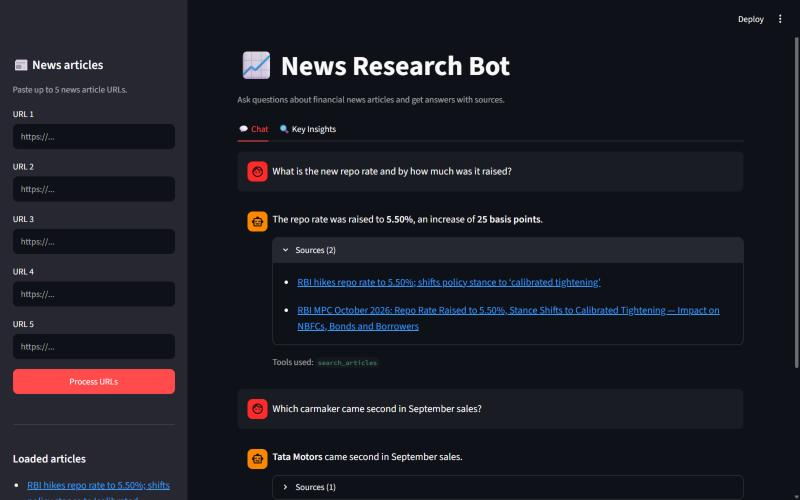
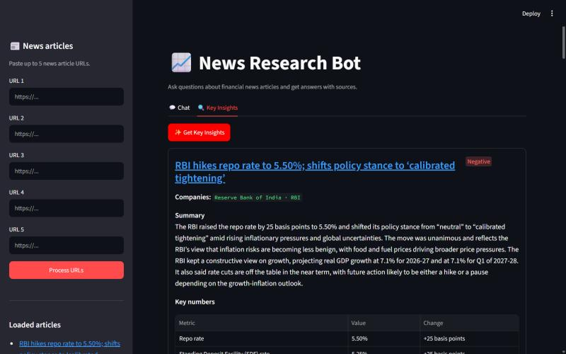
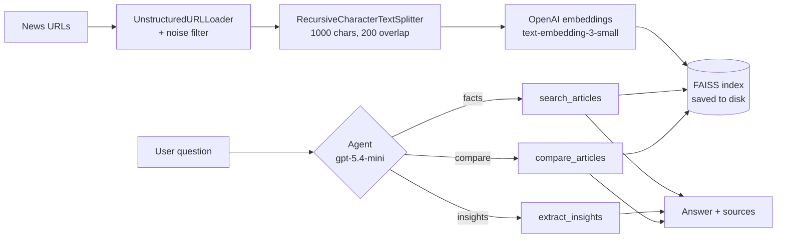

# 📈 News Research Bot for Financial Analysis

A chatbot for financial news research. Paste links to news articles, and the bot reads them, stores them in a vector database and answers your questions **using only those articles, with sources**. It also pulls out key investor insights for each article (summary, companies, key numbers, sentiment, takeaway). A small **AI agent** decides which tool to use for each question.

Built with **LangChain** (FAISS, UnstructuredURLLoader, RecursiveCharacterTextSplitter), the **OpenAI API** and **Streamlit**.

| Chat with sources | Key insights |
|---|---|
|  |  |

---

## Features

- **Q&A over news articles.** Answers come only from the loaded articles. Every answer lists the article(s) it used, and if the answer isn't in the articles, the bot says so instead of guessing.
- **Follow-up questions.** Chat history lets you ask "What about its revenue?" after a question about a company.
- **Key insight extraction.** One click gives each article a 3–5 sentence summary, companies and tickers, important figures, sentiment (Positive / Negative / Neutral) with a reason, and the main investor takeaway. Output is structured (Pydantic), so the UI shows it as neat cards.
- **Agent with 3 tools.** A tool-calling agent picks:
  - `search_articles`: factual questions (the default)
  - `extract_insights`: insights for one article
  - `compare_articles`: what different articles say about the same company or topic
- **Robust loading.** Strips page clutter (share-price tickers, menus, legal footers), falls back to `WebBaseLoader` when `UnstructuredURLLoader` fails, skips paywalled or blocked pages with a warning, and removes duplicate chunks.
- **Saved index.** The FAISS index is saved to disk, so articles stay loaded between runs.

## How it works



1. **Load:** each URL is downloaded and split into page elements. Only real article text (paragraphs, tables, full bullet points) is kept.
2. **Split:** articles are cut into overlapping chunks so related sentences stay together.
3. **Embed and store:** each chunk becomes a vector, and FAISS stores them for fast similarity search.
4. **Answer:** a follow-up is first rewritten as a standalone question. The top 4 matching chunks are retrieved, and the LLM answers from those chunks only and says which ones it used. Those become the sources.

## Tech stack

| Part | Tool |
|---|---|
| LLM (chat, insights, agent) | OpenAI `gpt-5.4-mini`, temperature 0 |
| Embeddings | OpenAI `text-embedding-3-small` |
| Vector database | FAISS (`faiss-cpu`) |
| Framework | LangChain 1.x (`langchain`, `langchain-community`, `langchain-openai`, `langchain-text-splitters`) |
| Loading | `UnstructuredURLLoader`, fallback `WebBaseLoader` |
| Structured output | Pydantic |
| UI | Streamlit |
| Tests | pytest |

## Project structure

```
├── app.py                # Streamlit UI
├── config.py             # models, chunk size, top-k, paths
├── requirements.txt
├── .env.example          # OPENAI_API_KEY=your-key-here
├── src/
│   ├── loader.py         # URL loading, noise filter, splitting, dedup
│   ├── vectorstore.py    # embeddings + FAISS build/save/load
│   ├── qa_chain.py       # retrieval Q&A with sources and chat history
│   ├── insights.py       # structured insight extraction
│   ├── agent.py          # agent + 3 tools
│   └── llm.py            # chat model + friendly error messages
├── tests/
│   ├── test_basic.py     # offline unit tests (no API calls)
│   └── run_evaluation.py # end-to-end checks with real articles
├── reports/
│   └── test_results.md   # latest evaluation results
├── docs/screenshots/
└── vectorstore/          # saved FAISS index (gitignored)
```

## Setup

**You need:** Python 3.10+ and an OpenAI API key with a few dollars of credit.

```bash
# 1. Create and activate a virtual environment
python -m venv venv
venv\Scripts\activate          # Windows
# source venv/bin/activate     # macOS / Linux

# 2. Install the packages
pip install -r requirements.txt

# 3. Add your OpenAI key
copy .env.example .env         # Windows  (macOS / Linux: cp .env.example .env)
```

Open `.env` and replace `your-key-here` with your key. The `.env` file is gitignored, so the key never goes into git.

## Run

```bash
streamlit run app.py
```

The app opens at http://localhost:8501.

1. **Sidebar:** paste up to 5 news article URLs and click **Process URLs**.
2. **💬 Chat tab:** ask questions. Expand **Sources** under an answer to see which articles it came from.
3. **🔍 Key Insights tab:** click **Get Key Insights** for one card per article.
4. **🗑️ Clear / start over** deletes the index and the chat.

You can also try each part from the terminal: `python -m src.loader`, `python -m src.vectorstore`, `python -m src.qa_chain`, `python -m src.insights`, `python -m src.agent`.

## Example Q&A

From the evaluation run on three Q2 FY27 IT results articles (TCS, HCLTech, Wipro):

| Question | Bot's answer | Source cited |
|---|---|---|
| What was TCS's consolidated net profit in Q2 FY27? | TCS's consolidated net profit in Q2 FY27 was ₹13,884 crore. | TCS (Upstox) |
| By how much did Wipro's net profit fall year on year? | Wipro's net profit fell by 1.40 per cent year on year, to Rs 3,200.6 crore from Rs 3,246.2 crore. | Wipro (HDFC Sky) |
| *(follow-up)* And how much did its net profit change? | Understood as *"How much did Wipro's net profit change?"* → fell 1.40% to Rs 3,200.6 crore | Wipro (HDFC Sky) |
| What was Infosys's net profit in Q2 FY27? *(not in the articles)* | I couldn't find that in the loaded articles. | – |
| Compare the net profit growth of TCS, HCLTech and Wipro | Table: HCLTech +21.2%, TCS +15%, Wipro −1.40% *(agent used `compare_articles`)* | All three |

## Configuration

All settings are in [`config.py`](config.py):

| Setting | Default | Notes |
|---|---|---|
| `CHAT_MODEL` | `gpt-5.4-mini` | Switch to `gpt-5.4-nano` to save credits (weaker agent and insights) |
| `EMBEDDING_MODEL` | `text-embedding-3-small` | **If you change this, clear and rebuild the index.** The app refuses to load an index built with a different model. |
| `TEMPERATURE` | `0` | Keeps answers factual |
| `CHUNK_SIZE` / `CHUNK_OVERLAP` | `1000` / `200` | Characters |
| `TOP_K` | `4` | Chunks retrieved per question |
| `HISTORY_TURNS` | `4` | Past Q&A pairs used for follow-ups |
| `MIN_ARTICLE_CHARS` | `500` | Pages with less text are skipped (paywall or blocked) |

## Testing

```bash
# Offline unit tests: splitting, loader fallbacks, index build/save/load (no API calls)
python -m pytest -v

# End-to-end evaluation with real articles (uses a few cents of OpenAI credit)
python -m tests.run_evaluation
```

**Latest results:** 14/14 unit tests pass, and the evaluation scored **15/15**. Full details are in [reports/test_results.md](reports/test_results.md).

| Check | Result |
|---|---|
| Factual questions: correct figure **and** correct source | 5/5 |
| Questions not in the articles: says it doesn't know | 2/2 |
| Follow-up question uses chat history | 1/1 |
| Key insights: right sentiment and ticker, every figure found in the article | 3/3 |
| Agent picks exactly the right tool | 4/4 |

## Known limitations

- **Paywalled or script-heavy sites** (some pages on Moneycontrol, Economic Times, Reuters) may return little text and are skipped with a warning.
- **Tickers** sometimes come from the model's general knowledge rather than the article, and it may give a "ticker" to an unlisted body (for example `RBI` for the Reserve Bank of India).
- **Facts are only as good as the article.** The bot repeats what the article says, including the article's own framing or mistakes.
- The index holds one set of articles at a time. Processing new URLs replaces it.
